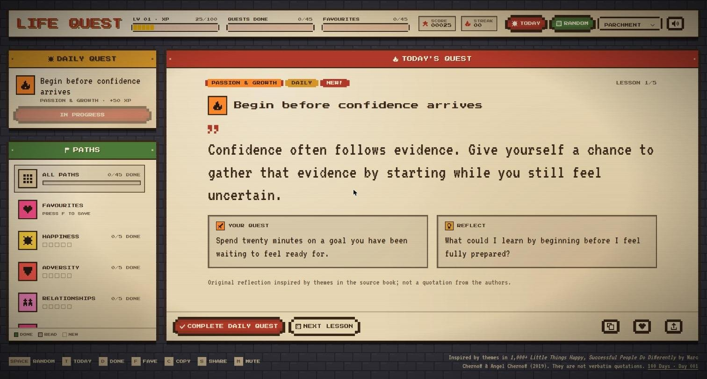
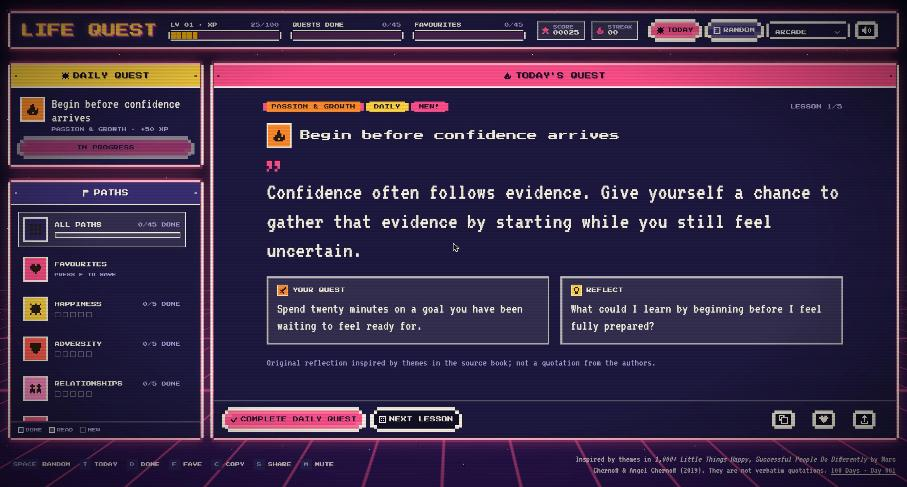

# Life Quest

An 8-bit daily quest for a better life. 45 short lessons across 9 paths, each one paired with a small real-world quest and a question to reflect on.

**▶ Play it live: https://life-quest.keyurib.workers.dev**

Day 1 of my [100 Days](https://100days.keyurib.workers.dev) series: one small experimental project, shipped every day.



## How it works

- **Today's Daily Quest.** One lesson per day, the same for everyone. The lessons rotate fairly: each one comes up once every 45 days, and the same path never appears two days in a row. Completing it earns bonus XP and builds your streak.
- **Paths.** Pick one of 9 paths (Happiness, Adversity, Relationships, Self-Love, Passion & Growth, Productivity, Goals & Success, Simplicity, Inspiration), or All paths. Random lessons never repeat until you have seen the whole path, then you move on to the next path automatically.
- **Your Quest and Reflect.** Every lesson has a short reflection, one small action to try, and a question to think about.
- **Complete the quest.** A lesson counts as done when you press **Complete Quest** after trying its action. Reading it alone does not count. Each path shows its progress: filled squares are done, shaded are read, empty are new.
- **Favourites.** Save any lesson with the heart, then pick the Favourites path to go back through just those.
- **Progress.** XP, levels, quests done and streak are saved in your browser.

## Themes

The default **Parchment** theme is a fantasy-RPG dashboard: parchment panels in pixel frames on a stone background. **Arcade**, **Pocket** and **Sunset** are also available from the theme picker. The layout fills the screen and scales with it, from laptops to large monitors, and stacks into one column on phones.



## Keyboard

| Key | Action |
| --- | --- |
| `Space` / `N` / `→` | Next lesson |
| `T` | Today's Daily Quest |
| `D` | Complete quest |
| `F` | Favourite |
| `C` | Copy lesson |
| `S` | Share |
| `M` | Mute sound |

## Built with

- [Next.js](https://nextjs.org), exported as a static site
- [8bitcn/ui](https://www.8bitcn.com) retro components on top of [shadcn/ui](https://ui.shadcn.com)
- Tailwind CSS, custom pixel-art icons, and chiptune sound effects made with the Web Audio API
- Hosted on Cloudflare Workers

## Content

All lessons live in [`src/data/life-quest-content.json`](src/data/life-quest-content.json), the single source of truth. [`src/lib/life-quest.ts`](src/lib/life-quest.ts) types and indexes it and picks the Daily Quest. The colour and icon for each path are in [`src/lib/category-theme.ts`](src/lib/category-theme.ts), kept apart from the content.

The lessons are original reflections inspired by themes in *1,000+ Little Things Happy, Successful People Do Differently* by Marc and Angel Chernoff (2019). They are not quotations from the book.

## Run it locally

```bash
npm install
npm run dev      # http://localhost:3000
```

## Build and deploy

```bash
npm run build          # static site in out/
npx wrangler deploy    # publish out/ to Cloudflare (see wrangler.jsonc)
```
